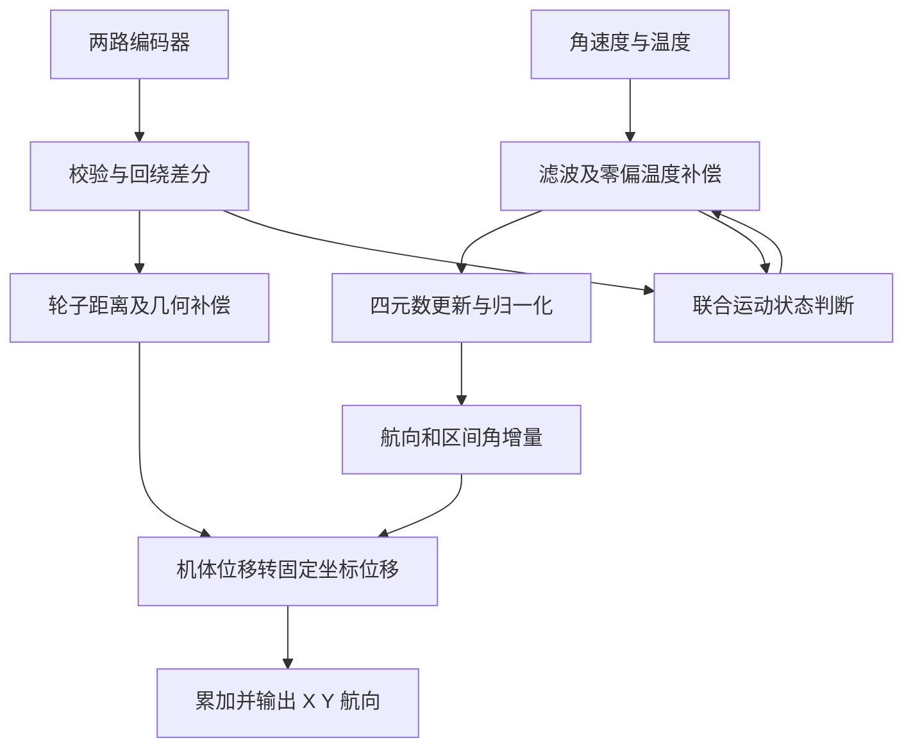

# 惯性传感器与正交里程计平面定位论文：完整学习与工程分析

阅读日期：2026-10-29。

工程状态更新（2026-10-31）：本文保留阅读当时的对比和建议；现固件已按用户要求替换为论文 KF/RK2 姿态链路，最新实现与限制见 [姿态模块说明](../modules/attitude/README.md)。下文“当前 Fusion”等描述均属于阅读时的历史状态。

来源：王厚伟，东北大学控制工程硕士学位论文，2018 年 12 月。

原文件：`C:/Users/Administrator/Documents/Tencent Files/732272608/FileRecv/基于惯性传感器与正交里程计的平面定位系统设计与实现_王厚伟.pdf`。

PDF 共 91 页，正文第 1 页对应 PDF 第 11 页。下文使用正文印刷页码，查阅 PDF 时加 10。文档覆盖研究问题、理论、补偿、解算、标定、实现、实验和局限；关键公式与表格结合页面图像核对。

**表述约定：**“论文内容”指作者给出的模型、参数和结果；“推导说明”是为解释原理而重新组织的表达；“本工程建议”针对 G354、MT6826S 和当前工程，不代表论文已经实现或证明。本文是研究笔记，没有修改固件或配置，也没有运行硬件。

## 1. 全文地图与核心思想

| 章节 | 正文页码 | 要解决的问题 |
| --- | --- | --- |
| 第 1 章 绪论 | 1-6 | 应用需求、已有技术与研究范围 |
| 第 2 章 相关技术 | 7-19 | 航迹推算、KF、最小二乘、姿态、坐标变换 |
| 第 3 章 陀螺仪补偿 | 21-38 | 随机噪声、启动零偏、温漂、静止和振动处理 |
| 第 4 章 位姿更新 | 39-51 | 四元数、计数差分、非正交补偿、坐标积分、标定 |
| 第 5 章 系统实现 | 53-68 | 电路、接口、驱动、Bootloader、任务组织 |
| 第 6 章 性能测试 | 69-74 | 旋转、角度跟随、位移跟随、方形路线 |
| 第 7 章 总结展望 | 75-76 | 复杂轨迹、区间运动模型、应用验证 |
| 参考文献、致谢 | 77-81 | 背景与研究来源 |

**整套系统的核心：陀螺仪判断朝向，两只近似正交的从动轮测量机体位移，将每小段位移转到固定坐标系，再逐段累加。**

论文硬件为 STM32F405RGT6、ICM20608、两只 AS5045B 绝对式磁编码器和带浮动机构的全向从动轮。软件采用 uC/OS-II，以 5 ms，即 200 Hz 更新位姿。



必须先区分五个概念：

1. **“正交”是两轮测量方向的机械关系。** 不要求编码器使用 AB 相。论文本身读取绝对式磁编码器，SPI 读取 MT6826S 与其思路相容。
2. **位置主要来自测量轮。** 第 2 章介绍加速度积分式惯导，但实际方案没有采用加速度二次积分作为主要位置来源。
3. **融合主要通过几何关系完成。** 论文没有建立完整的 IMU/里程计位姿 EKF；自适应 KF 主要给角速度降噪。
4. **输出是航迹推算的相对位姿。** 没有外部参考就会累计误差，不能因此获得长期绝对位置或地理北向。
5. **绝对式编码器只给单圈绝对角。** 多圈里程仍需连续采样、展开和标定；当前角度不能自动恢复断电或缺测期间的运动。

## 2. 第 1 章：为什么这样设计

### 2.1 目标与应用背景

论文来源于移动机器人定位需求，尤其面向竞赛场地，希望开发结构紧凑、成本适中、实时输出平面位姿、可以独立挂载在底盘上的模块。

作者讨论 GPS、超声、视觉、SLAM 等路线。其优劣评述应放在 2018 年技术与具体应用条件下理解，不能泛化为今天“所有 SLAM 都慢”或“所有 GPS 都不准”。SLAM 可以建立相对地图坐标系，是否具有地理绝对参考取决于外部约束。

### 2.2 陀螺仪与从动轮为什么互补

陀螺仪擅长短时角运动测量，零偏却会积成角度误差。轮子直接测行程，避免加速度偏置经二次积分迅速形成位置误差。全向轮主滚动方向用于测距，垂直方向通过小滚子释放运动约束，适合两个方向同时测量。

从动轮不承担驱动力，减少驱动轮加减速打滑的直接影响；浮动机构帮助贴地。但轮子悬空、接触压力变化、轮面压缩、地面接缝、滚子不均匀和横向摩擦仍会造成误差。算法依赖有效机械接触。

这篇论文的价值是把误差处理、机械几何、标定、嵌入式实现串成完整路线。不能只拿最后的坐标公式而省掉前面的条件。

## 3. 第 2 章：后续算法的数学基础

### 3.1 航迹推算

最简单的单方向模型为：

```text
x[k+1] = x[k] + ds*cos(theta)
y[k+1] = y[k] + ds*sin(theta)
```

全向机器人可能侧移，机头方向与位移方向不相同，必须保留两个机体位移分量：

```text
[dx_n]   [cos(theta) -sin(theta)] [dx_b]
[dy_n] = [sin(theta)  cos(theta)] [dy_b]
```

b 为随机器人旋转的机体系，n 为固定导航系。轮子测得机体方向的投影，航向负责转换方向关系，再对固定坐标增量累加。不能把所有运动都当作沿 yaw 前进。

### 3.2 卡尔曼滤波

一般线性模型：

```text
x[k] = F*x[k-1] + w[k-1]
z[k] = H*x[k] + v[k]
```

x 是待估计状态，z 为含噪测量，F 描述状态变化，H 描述观测关系，Q 是过程噪声协方差，R 是测量噪声协方差。标准执行顺序可明确写为：

```text
x_pred = F*x_previous
P_pred = F*P_previous*F^T + Q
innovation = z-H*x_pred
S = H*P_pred*H^T + R
K = P_pred*H^T*inverse(S)
x_updated = x_pred+K*innovation
P_updated = (I-K*H)*P_pred
```

新息 innovation 是“测量减预测”，不是“测量减已经修正的结果”。K 决定更信测量还是模型。R 大通常更平滑，Q 大通常更快跟随变化。平滑与动态响应需要取舍。

所谓最优依赖模型和噪声统计条件，自适应公式也不会自动正确区分真实运动和噪声。

### 3.3 最小二乘

选取基函数 phi，拟合 `y_hat(t)=phi(t)*beta`，以残差平方和最小估计 beta。把各采样时刻的 phi 排成设计矩阵 A，就得到：

```text
beta_best = argmin ||A*beta-y||^2
```

温度拟合可选 `[1,T]`，振动拟合可选常数、正弦和余弦。满足条件时形式解为 `(A^T*A)^-1*A^T*y`，实际数值求解优先考虑 QR 等方法，避免显式求逆。

固定采样时刻、固定候选振动频率的模型可以预计算矩阵，这是工程优化建议。平方损失对离群点敏感，采集标定数据时还要检查坏点。论文对“平方比绝对值容易计算”的解释较简化，不能把它当作选择最小二乘的普遍性能结论。

### 3.4 姿态的三种表示

| 表示 | 内容 | 作用 | 限制 |
| --- | --- | --- | --- |
| 方向余弦矩阵 | 3×3 矩阵 | 直接做向量坐标转换 | 要保持正交、行列式 +1 |
| 欧拉角 | 有顺序的三个角 | 方便观察与解释 | 旋转顺序、奇异性和回绕 |
| 单位四元数 | 四个分量 | 连续姿态积分 | 范数、乘法方向与分量顺序 |

角轴表达为：

```text
q = [cos(phi/2), ux*sin(phi/2), uy*sin(phi/2), uz*sin(phi/2)]
ux^2+uy^2+uz^2 = 1
q0^2+q1^2+q2^2+q3^2 = 1
```

q 与 -q 表示同一姿态。多轴角速度不能简单各自独立积分成三个欧拉角，需用完整姿态运动学。

论文使用 Z-X-Y 欧拉顺序，当前 Fusion 使用的 Z-Y-X 输出不能逐项替换。机体轴、右手规则、角速度单位、主动旋转/坐标变换、q 表示 b→n 还是 n→b，都必须统一。

### 3.5 正交旋转与非正交测量矩阵

真正的旋转矩阵满足 `R^-1=R^T`、`R^T*R=I`、`det(R)=1`。两只非正交轮的测量矩阵通常不满足这些条件，逆不能直接换成转置。

论文虽提到“东北天”，初始化为零主要建立局部参考，并不意味着没有北向传感器的系统已经对准地理北方。

## 4. 第 3 章：陀螺仪误差补偿

### 4.1 误差分类和处理分工

解释用的统一模型为：

```text
omega_measured = (1+scale_error)*omega_true
                 + bias_start + bias_temperature(T) + noise
```

这不是论文原式的逐字转录。论文讨论零点常值误差、随机误差、温漂、刻度因子误差；更一般的安装及交叉轴误差可扩展为矩阵，但论文未给出完整多轴标定方案。

| 误差 | 论文处理 | 边界 |
| --- | --- | --- |
| 随机噪声 | 自适应 KF | 平滑不等于消除平均偏置 |
| 启动常值零偏 | 静止采集 | 不能涵盖后续温度变化 |
| 温漂 | 温度数据、一次拟合 | 不保证全温区线性、无迟滞 |
| 刻度因子误差 | 建立误差模型 | 未展示完整独立标定流程 |
| 运行期间偏置变化 | 静止检测后二次补偿 | 错判会把慢转学走 |
| 振动干扰 | 特定频率识别、归零或缩放 | 可能丢掉同时发生的真实转角 |

### 4.2 自适应角速度 KF

正文 24-25 页把角速度按随机游走建模：`x[k+1]=x[k]+w[k]`、`z[k+1]=x[k+1]+v[k+1]`，即 F=H=1。初始化静止数据估计 R，运行中固定 R；最近 N=10 个新息用于调整 Q。

为消除原文排列顺序与索引歧义，可整理为：

```text
x_pred = x_previous
P_pred = P_previous+Q_previous
r = z-x_pred
K = P_pred/(P_pred+R)
x_updated = x_pred+K*r
P_updated = (1-K)*P_pred
C = mean(last_N_innovations_squared)
Q_next = K*K*C
```

这是明确执行顺序后的表达。窗口未填满时怎么办、R 的正下限、Q 的限幅及坏点处理，需要实现时补全。

原式 (3.6) 在计算 K 前列出状态修正；(3.7) 引用同标号 Q，Q 却在末尾更新；(3.11) 写 Z_j-X_j，未清楚区分预测和后验状态。不能按排版顺序直接编写。

真实急转也会引起新息变化。滤波器不能凭这些方程证明变化一定来自噪声，平滑波形必须同时评估延迟和角速度积分面积误差。

### 4.3 启动零偏

真实静止时平均角速度近似为零，用采样均值估计偏置并扣除。均值用于估计偏移，方差 R 用于描述噪声，两者不能互相替代。论文没有充分说明本工程应采多少点、等多久热稳定，以及发生启动运动时如何拒绝标定。

### 4.4 温漂补偿

正文 26-28 页在上电自然温升期间每隔 0.5 ℃ 存一组温度与零偏，约 23-26 ℃ 共 7 个点，存入 Flash；再对各轴拟合一次函数。统一用 T 表示温度：

```text
b_x(T)=a_x*T+c_x
b_y(T)=a_y*T+c_y
b_z(T)=a_z*T+c_z
```

a 单位为 (°/s)/℃，c 为 °/s。论文报告补偿前可达 0.2 °/s 以上，补偿后降至 0.01 °/s 以内，属于作者器件和该组工况的结果。

恒定残余偏置 b 会产生 `angle_error≈b*time`。0.001 °/s 积分 1000 s 就是 1°，所以滤掉抖动不能代替偏置补偿。

若启动均值 b_start 已含启动温度 T_start 的完整偏置，一个避免重复扣除的工程表达为：

```text
omega_corrected = omega_measured-b_start
                  -(b_model(T)-b_model(T_start))
```

启动均值负责起始总偏置，模型只负责相对启动温度的变化。若另有在线偏置学习，它应明确估计剩余项，不能几套逻辑重复扣同一偏置。

约 3 ℃ 自然温升不能证明全温区线性。升降温可能有迟滞，内部温度与结构温度也未必同步。应真正静止采集，用独立数据检查残差、升降温一致性和跨次上电重复性。

**对应 G354：** 同次运行 27 ℃ 附近较稳、25 ℃ 和 28 ℃ 更漂，可能涉及残余温度偏置，但还不能唯一确定原因。不得使用 ICM20608 的系数。

此前 20 分钟 yaw 约漂 1°，等效平均残余为 `1/1200≈0.000833 °/s`。这是净积分等效值，不是每点误差，可能有正负抵消。因此论文“0.01 °/s 以内”并不自动优于现有长时间表现。

### 4.5 固定死区的代价

论文补偿后使用 0.15 °/s 阈值，低于阈值归零。支持正反转时应比较绝对值：

```text
if abs(omega_corrected)<threshold: omega_used=0
else: omega_used=omega_corrected
```

原文“大于阈值才有效”不能只按正数比较，否则会丢弃负方向转动。

作者明确假设极慢真实转动较少。实际 0.1 °/s 转 60 s 是 6°，可能被全部抹掉。0.15 °/s 约为当前长时等效残余的 180 倍，不适合因为来自论文就直接照搬。

### 4.6 联合静止检测

正文 29-31 页要求连续 20 个周期同时满足：补偿后角速度绝对值不超过 0.04 °/s；编码器相对输出绝对值不大于 1 count；20 个相对输出的和小于 5。5 ms 周期对应约 100 ms，20 个采样时刻首尾跨度是 95 ms。

陀螺仪主要判断转动，匀速直线平移不必产生明显角速度；轮子补充线运动信息。轮子接触失效也会输出接近零，所以还要保证机械与数据有效。

原文没有明确求和是否取绝对值。带符号和可能正负抵消。工程上可同时考虑每点幅度、净增量、绝对增量和稳定性，配合加速度及有效标志，这是补充建议。

静止检测应观察死区前信号。若先用 0.15 °/s 归零，再检查 0.04 °/s，检测将失去一部分意义。原文未完整交代这一处理顺序。

### 4.7 二次零偏与渐进收敛

作者比较瞬时值补偿、均值补偿与渐进收敛：瞬时值容易带入噪声，均值需等待窗口，渐进收敛在确认静止后用小步调整。

原文递减单位写“0.0001 度”，被补偿量却是角速度，更新频率和递推式不充分。不能直接把这个数作为每次任务的固定修正。

一种便于定义时间常数的工程方案是在可信静止时更新剩余偏置：

```text
alpha=1-exp(-dt/tau_bias)
bias_residual += alpha*(omega_after_temperature-bias_residual)
omega_used=omega_after_temperature-bias_residual
```

这不是论文原递推式。静止误判会把真实慢转学走，应在运动、异常数据及不可信振动时禁止学习。

论文约 60 s 间歇直线往复测试中，漂移约由 1.1° 降至 0.4°。它支持利用停车片段更新偏置，但不证明持续运动时同样有效，也不能自动恢复过去已积累的航向误差。

### 4.8 振动识别与处理

正文 33-37 页以 48 Hz 振动为例，200 Hz 采样，20 点窗口、间隔 5 ms。设角频率 Omega=2*pi*f，基函数为：

```text
phi(t)=[1,sin(Omega*t/2),cos(Omega*t/2),
          sin(Omega*t),cos(Omega*t),
          sin(3*Omega*t/2),cos(3*Omega*t/2)]
beta=[a0,a1,a2,a3,a4,a5,a6]^T
A[j,:]=phi(t[j])
solve min ||A*beta-W||^2
```

时间样本为 `1,1.005,...,1.095 s`。A 应为 20×7 矩阵。原式 (3.20) 写 T*Phi*a=W，未给出一致矩阵维数，时间向量不能直接乘一个基函数向量替代设计矩阵。

成对正余弦振幅分别为 `sqrt(a1²+a2²)`、`sqrt(a3²+a4²)`、`sqrt(a5²+a6²)`。论文系数：

```text
[-0.0025,-0.0124,-0.0069,-0.1559,-0.2360,0.0112,-0.0046]
```

由此计算振幅约为 0.0142、0.2828、0.0121 °/s，48 Hz 主频占主导。模型考察的是 24、48、72 Hz；这属于已知频率模板，不能据此宣称能自动辨识所有未知、变频或宽带振动。

20 点需约 95 ms 首尾跨度，滑动更新不能消除窗口观测时间。若主频换成 80 Hz，1.5 倍频 120 Hz 已超出 200 Hz 采样的奈奎斯特频率，同一模板不能无条件使用。传感器带宽、滤波及混叠也需要考虑。

论文识别后将角速度归零，或乘 0.4，再结合阈值压低漂移；约 9 s 示例未处理角度漂到约 -0.7°。该策略隐含基本没有真实转动的条件。机器人同时转弯时，归零会丢失真实转角，缩放会造成比例误差，不能称为通用无失真去振算法。

## 5. 第 4 章：姿态与位置更新

### 5.1 四元数初始化和运动学

论文设置 `q=[1,0,0,0]`，把启动姿态定义为参考姿态。它不等于自动完成水平找正或北向对准。

为避免约定混乱，下面采用 q=[w,x,y,z]、Hamilton 乘法、机体到导航主动旋转、角速度以机体系表达，则：

```text
q_dot=0.5*M(omega)*q

             [0  -wx -wy -wz]
M(omega)=    [wx  0   wz -wy]
             [wy -wz  0   wx]
             [wz  wy -wx  0 ]
```

角速度必须为 rad/s，°/s 先乘 pi/180。其他约定可能导致不同符号和乘法方向，但必须全链路一致。

### 5.2 二阶龙格库塔积分

按论文思路整理成无歧义的 Heun 形式：

```text
f(q,w)=0.5*M(w)*q
k1=f(q_previous,w_previous)
q_predict=q_previous+dt*k1
k2=f(q_predict,w_now)
q_now=q_previous+dt*(k1+k2)/2
q_now=q_now/norm(q_now)
```

若把 dt 提前并入 d1、d2，最终必须为 `q_previous+(d1+d2)/2`。

**原式核对：** (4.5) 微分矩阵前未写 1/2，(4.6)、(4.8) 却含 dt/2；(4.9) 直接相加两段增量，没有按照通用 RK2 式 (4.3) 再除以 2。按字面实现会有角度比例风险。论文未附完整源码，不能据此断言实际程序也有同样问题。

归一化保持单位范数，不能消除零偏、温漂、延迟或错误积分系数。RK2 改进数值积分，没有提供绝对 yaw 观测。

### 5.3 姿态矩阵与欧拉角

上述约定下的参考矩阵为：

```text
R=[1-2(y²+z²), 2(xy-wz),   2(xz+wy)  ]
  [2(xy+wz),   1-2(x²+z²), 2(yz-wx)  ]
  [2(xz-wy),   2(yz+wx),   1-2(x²+y²)]
```

ZYX 输出可写为：

```text
yaw=atan2(2*(w*z+x*y),1-2*(y*y+z*z))
pitch=asin(clamp(2*(w*y-z*x),-1,1))
roll=atan2(2*(w*x+y*z),1-2*(x*x+y*y))
```

这是统一约定下的参考，不能拿它逐项替换论文 ZXY 原式。工程中应采用已确认的 Fusion 定义。atan2 用于保留象限，asin 要限幅，欧拉奇异点仍需处理。论文 (2.34) 有部分符号/下标疑点，详见第 9 节。

### 5.4 编码器差分与回绕

AS5045B 为 12 位，N=4096，论文每 5 ms 做相邻位置差分：

```text
dc=c_now-c_previous
if dc>N/2: dc-=N
if dc<-N/2: dc+=N
```

4090→5 原差 -4085，展开为 +11；5→4090 则为 -11。恰好半圈有方向歧义。必须保证相邻有效采样之间真实转动小于半圈：

```text
abs(rpm)<60/(2*dt)
```

5 ms 对应小于 6000 rpm，1 ms 对应小于 30000 rpm。这只是展开数学条件，不是芯片、磁铁或机械额定转速；丢帧要按更长有效间隔计算。

MT6826S 使用 N=32768，不能保留论文 4096/2048。绝对单圈测量也无法恢复缺失了几整圈。

### 5.5 计数转距离

设 D_i 为有效轮径，g_i 为编码器转数/轮子转数，s_i 为正负安装方向：

```text
distance_per_count_i=s_i*pi*D_i/(N_i*g_i)
ds_i=distance_per_count_i*dc_i
```

同轴直连 g=1，有效轮径包含接触和受力影响。例：D=50 mm、N=32768、直连时，每 count 约 0.004794 mm，1024 counts 约 4.9087 mm。高分辨率不能消除轮径误差、偏心或打滑。

位置应由健康累计计数差换算，不能为了波形平滑而从滤波 RPM 重新积分。速度低通用于显示和控制，里程计数用于几何位置。

### 5.6 论文的非正交补偿

正文 43-46 页针对对称结构，按直角、锐角、钝角建立辅助坐标系。其角度定义下，先计算：

```text
X_f=2*pi*R0*dc0/(4096*cos(2*gamma))
Y_f=2*pi*R1*dc1/(4096*cos(2*gamma))
```

锐角情形再做：

```text
[dx_b]   [cos(gamma) sin(gamma)] [X_f]
[dy_b] = [sin(gamma) cos(gamma)] [Y_f]
```

钝角时两个非对角项改为 -sin(gamma)，正交时 gamma=0。

后面的矩阵不是普通旋转，其两项同号属于非正交投影求解。必须与前面的 cos(2*gamma) 分母整体理解，不可省略、重复补偿，也不能把逆直接换成转置。两轮接近平行时会放大噪声。

### 5.7 通用安装几何与转动补偿

以下为本工程的通用小增量推导，不是论文原公式。

机体参考点为 O，轮子 i 的测量滚动方向角为 alpha_i，相对 O 的位置为 (x_i,y_i)。alpha 是滚动测量方向，通常与轮轴方向相差 90°。

平面刚体转动在轮子位置产生切向运动，因此：

```text
ds_i=cos(alpha_i)*dx_b+sin(alpha_i)*dy_b
     +(-y_i*cos(alpha_i)+x_i*sin(alpha_i))*dtheta

l_i=-y_i*cos(alpha_i)+x_i*sin(alpha_i)
m_i=ds_i-l_i*dtheta

H=[cos(alpha1) sin(alpha1)]
  [cos(alpha2) sin(alpha2)]
[dx_b,dy_b]^T=inverse(H)*[m1,m2]^T
```

dtheta 用弧度，位置和距离单位一致。`det(H)=sin(alpha2-alpha1)`，近似正交有利于求解，接近平行则病态。

例：沿 X 测量的轮子放在 y=100 mm 处，l=-100 mm；参考点原地逆时针转 1°，该轮因转动产生约 -1.745 mm 行程。不扣除会被误认为平移。如果实际几何使 l=0，该项自然消失；不知道安装位置时不能默认所有轮子均为零。

论文结构与参考点较特殊，不能直接适配任意底盘。原地旋转是否产生虚假 X/Y，是后续几何模型应检查的现象。

### 5.8 中点航向与位置累加

论文 (4.26) 使用前后航向平均，(4.27) 旋转位移。考虑显示角回绕后应写为：

```text
dtheta=wrap_to_pi(theta_now-theta_previous)
theta_mid=theta_previous+0.5*dtheta
dx_n=cos(theta_mid)*dx_b-sin(theta_mid)*dy_b
dy_n=sin(theta_mid)*dx_b+cos(theta_mid)*dy_b
x_now=x_previous+dx_n
y_now=y_previous+dy_n
```

+179°→-179° 的短程角差是 +2°，中点约 180°，直接平均成 0°会把方向反转。机体朝向 90°时，机体 X 前进 10 mm 对应固定 Y 增加 10 mm。

论文 (4.28) 还有固定 -45° 旋转：

```text
[ cos(pi/4) sin(pi/4)]
[-sin(pi/4) cos(pi/4)]
```

这是作者结构的输出参考方向。我们按实际机体系定义决定固定旋转，不能无条件加 45°。

### 5.9 中点近似与 SE(2) 的关系

中点法假设区间运动足够平滑，仍受角加速度、不同步和大步长影响。明确假定区间内机体系速度和角速度恒定，若 `[u,v]=[vx*dt,vy*dt]`、phi=dtheta，则可推导：

```text
delta_p_n=sinc(phi/2)*R(theta_previous+phi/2)*[u,v]^T
sinc(a)=sin(a)/a, sinc(0)=1
```

这等价于相应 SE(2) 积分。中点法把 sinc 因子近似为 1，小 phi 时差异约 phi²/24。不能用于没有定义清楚的任意位移，也不能恢复区间未知加减速。第一版优先保证模型和同步正确。

### 5.10 两只轮子为什么不能自动修正 yaw

一般平面运动有 dx_b、dy_b、dtheta 三个未知量，两轮只有两个独立方程。陀螺仪提供 dtheta 后才可求平移；不能反过来宣称这两轮独立解出了全部位姿并校正 yaw。

停车约束能更新零偏，但不能直接知道过去漂掉的绝对航向。加速度重力方向可约束 roll/pitch，不能直接约束绕重力方向的 yaw。

进一步约束长期航向需要额外信息：独立航向、外部定位、第三只适当布置的轮子或其他有效运动约束。第三只轮子也仍有滑移和累计误差，不自动得到地理绝对航向。

### 5.11 轮径与角度标定

正文 47-50 页使用 730 mm 导轨、旋转机构和刻度盘，保持已知方向、已知距离平移，记录计数，逆算轮径与安装夹角；报告实际夹角 89.85°。

(4.29)-(4.30) 按原文角度定义采用 sin/cos 投影，(4.30) 首项计数下标与文字定义不一致。不能单独照抄下标，也不能把“沿 X 用 sin”当通用规律。

以本工程 alpha 表示测量方向，无转动时统一写为：

```text
C_i=k_i*cos(alpha_i)*delta_x_b+k_i*sin(alpha_i)*delta_y_b
```

k_i 单位 counts/长度。沿机体 X 移动 Lx、沿 Y 移动 Ly，记录 Cix、Ciy：

```text
a_i=Cix/Lx
b_i=Ciy/Ly
k_i=sqrt(a_i*a_i+b_i*b_i)
alpha_i=atan2(b_i,a_i)
distance_per_count_i=1/k_i
D_effective_i=N_i*g_i/(pi*k_i)
```

安装反向可含在 alpha 或独立 sign 中，但不要重复反向。建议多方向、多距离、正反向和重复采集，最小二乘拟合 `C_i=a_i*dx+b_i*dy`；标定与验证数据分开。只沿一个方向无法充分分离尺度与方向。

原地旋转可估计 l_i，但 l_i 只是 x_i、y_i 的组合，不能靠单个数恢复完整安装位置。

### 5.12 标定结果与证据范围

原表 4.1、4.2 的模长及相对 730 mm 的差值如下，单位 mm：

| 方向 | 未补偿模长 | 模长误差 | 补偿后模长 | 模长误差 |
| --- | ---: | ---: | ---: | ---: |
| 0° | 736.26 | +6.26 | 730.43 | +0.43 |
| 30° | 733.31 | +3.31 | 729.90 | -0.10 |
| 60° | 728.03 | -1.97 | 730.57 | +0.57 |
| 90° | 726.54 | -3.46 | 729.98 | -0.02 |
| 120° | 729.15 | -0.85 | 730.08 | +0.08 |
| 150° | 733.51 | +3.51 | 729.21 | -0.79 |
| 180° | 736.18 | +6.18 | 729.83 | -0.17 |

原表算术整理：最大模长绝对误差从 6.26 mm 降到 0.79 mm，平均绝对误差从约 3.649 mm 降到 0.309 mm。这不是新增实验。

这不等于二维坐标误差小于 0.79 mm。补偿后 0° 行 X=4.83、Y=-730.42，模长很准但横向分量仍不为零。长度准确性和方向准确性应分别判断。

两张表部分方向的 X/Y 正负号不一致，方向约定未充分解释。本文不擅改原表符号，也不用这些行反推出精确角度；稳妥结论是该组数据的距离模长一致性得到改善。

## 6. 第 5 章：硬件、驱动与任务实现

### 6.1 硬件系统

| 模块 | 论文实现 | 应理解的工程作用 |
| --- | --- | --- |
| 主控 | STM32F405RGT6，168 MHz，Cortex-M4/FPU | 传感器读取、浮点计算、调度和输出 |
| 惯性感知 | ICM20608，角速度和温度 | 提供姿态积分输入及温漂补偿自变量 |
| 里程计 | 两只 12 位 AS5045B、全向从动轮 | 提供滚动方向上的位移 |
| 供电 | DC 5 V，TPS54560B-Q1、TPS73233 等 | 稳压、3.3 V 供电与保护 |
| 输出 | USART，经 RS232 电平转换和保护 | 对外发送位姿数据 |
| 机械 | 浮动贴地、同轴磁铁、紧凑双轮结构 | 测量有效性的基础 |

FPU 便于浮点运算，不等于所有矩阵求逆都便宜，也不能代替实际执行时间评估。原文没有给完整 CPU 占用、堆栈和最坏执行时间数据。

磁编码器需要正确磁铁尺寸、气隙、同轴度和磁场强度。高角分辨率不保证安装后的同等角精度。论文提到屏蔽线、静电防护和供电处理，说明通信与机械可靠性都属于定位链路的一部分。

### 6.2 外设资源与通信

论文表 5.1 和接口说明：

| 功能 | 引脚/配置 |
| --- | --- |
| IMU 的 SPI1 | PA4、PA5、PA6、PA7 |
| 编码器的 SPI2 资源 | PB12、PB13、PB14、PB15 |
| 两编码器实际片选 | PB12、PB15，分时选择 |
| 编码器共享线 | PB13 时钟、PB14 数据输入 |
| 位姿 USART3 | PB10、PB11 |
| 调试 | PA13、PA14，原表称 JTAG，实际两线对应 SWD 形式 |

注意 PB15 在这里用于第二片选，不是照通用 SPI2 全双工接线作为 MOSI。两只 AS5045B 共用时钟和数据，独立片选；本工程两只 MT6826S 分别使用 SPI1/SPI2，读写协议也不同。

论文 SPI：ICM20608 为 8 位、Mode 0；AS5045B 为 8 位、Mode 3、单向读取。不能因论文 IMU Mode 0 就修改 G354，模式必须服从各芯片数据手册。

### 6.3 AS5045B 驱动流程

论文读取 18 位帧：12 位角度和 OCF、COF、LIN、MagINC、MagDEC、PAR 六位状态/校验信息，软件通过 3 个字节承载。读取后进行校验、异常计数和角度返回。

学习重点是**有效性先于积分**。通信读到了一个数，不等于这个数是健康角度。具体状态位极性须查 AS5045B 原手册，不能把这些位直接映射到 MT6826S 的 CRC、告警和格式检查。

论文流程在校验失败时跳过更新并报错，但没有完整说明恢复阶段如何处理缺失运动。当前工程已对连续性丢失做锁存，定位层应继续传播该状态；不能刚恢复一帧健康数据就宣称累计位置重新完整。

### 6.4 IMU 驱动与寄存器配置

论文采用 SPI 地址帧和数据帧、寄存器回读验证初始化，选取 ±500 °/s 量程。表 5.3 列出：

| 地址 | 原文说明 | 写入值 |
| --- | --- | --- |
| 0x19 | 采样速率 | 0x07 |
| 0x1A | 滤波器参数 | 0x00 |
| 0x1B | 陀螺仪量程 | 0x08 |
| 0x6A | FIFO 功能配置 | 0x10 |

这些是原表转录，不代表本文已经根据芯片手册确认了所有含义。任务 200 Hz 不等于传感器内部输出必然 200 Hz，具体要结合 DLPF、分频和数据更新机制核实。

正文 63 页文字把读操作描述为最高位 0、写为 1，但下一页图 5.15 写操作为 `Address&0x7F`、读操作为 `Address|0x80`，二者相反。代码应以原厂手册和验证结果为准。论文还出现“2500 °/s”量程表述，不能据此认定为器件有效配置。

回读可以验证寄存器写入，不等于验证有效采样率、信号带宽、轴方向或比例系数，这些要分别确认。

### 6.5 定时器与输出带宽

论文使用 TIM7：定时器时钟 84 MHz、PSC=83、ARR=4999：

```text
period=(PSC+1)*(ARR+1)/timer_clock
      =84*5000/84000000=0.005 s
```

要用实际定时器时钟，注意 STM32 APB 分频对定时器时钟的影响。定时器中断可以周期唤醒任务，但不保证任务每次零延迟执行，实际积分还需考虑采样时刻和执行抖动。

USART 配置为 115200、8N1，每 5 ms 输出。按每字节 10 个串行位计算，理论有效字节率约 11520 B/s，200 Hz 时平均每帧预算约 57.6 B，尚未扣除其他开销。这是带宽推导，不是论文给出的完整帧格式。

MCU 的 3.3 V 逻辑输出与 RS232 电平需通过收发器转换。原文“TTL 正为 5 V”的概述不能理解为 STM32 TX 必须输出 5 V。

### 6.6 Bootloader

论文上电先初始化 TIM2、USART1，判断升级握手，必要时接收固件更新，然后跳转 `0x08004000` 执行位姿程序。注意升级 USART1 与运行输出 USART3 不是同一个接口。

学习其“升级与应用分离”的结构即可。原文没有给出完整镜像校验、断电恢复、原子升级等设计，不能据此认为已具备这些能力。第一版定位算法也不依赖先增加 Bootloader。

### 6.7 软件层次与两个任务

论文三层为硬件驱动层、操作系统层、应用层；与用户要求的 bsp/modules/application 划分不是完全相同。

ConfigureTask：初始化 NVIC、TIM7、SPI、USART3、IMU，读取 Flash 中参数，然后挂起。

UpdateTask：等待 5 ms 信号量，读取角速度，做静态误差补偿和动态状态处理，四元数更新并输出欧拉角；读取编码器差值并校验，计算机体步进、导航步进和累计坐标，最后输出。

静止判别同时使用轮子和 IMU，而流程先处理 IMU 后读本周期编码器，原文没有交代状态判别是否使用上一周期数据。实现时需明确数据时间关系。

信号量在任务超时情况下可能积压，也可能合并唤醒，取决于具体机制。不能假定“等待到一次信号量就一定恰好过去 5 ms”。算法应明确真实时间戳、超时及积压处理。

## 7. 第 6 章：实验到底证明了什么

### 7.1 变速旋转：1080° 后约 0.8° 误差

正文 69-70 页使用手动旋转平台、刻度盘，夹杂停止和变速，累计旋转三圈。终点报告角度约 0.8°，相对 1080° 约为 0.0741%，小于千分之一。

支持结论：该工况下一次累计旋转的终点角度误差较小。不能推成所有时刻误差均小于 0.8°、全温区相同或长期静止漂移得到同等保证；终点还可能包含不同误差的相互抵消。

### 7.2 航向跟随

正文 70-71 页，STM32F407 控制 Copley 驱动器与 Maxon 电机做 200° 摇摆，比较电机编码器和定位输出。曲线基本重合，定性支持跟随性良好。

缺少明确的 RMSE、最大动态误差、相位延迟及时间对齐统计，不能只凭图判定具体毫秒延迟或完整动态精度。

### 7.3 坐标跟随

正文 71-72 页采用 SIKO MSK200 读数头和 MB500 磁栅尺，标称分辨率 0.05 mm，比较沿 Y 轴的位移。曲线接近，终点一致性较好。

分辨率不等于整个标定平台的绝对测量准确度。该结果支持单轴跟随，不能直接证明任意 X/Y 曲线、转弯过程或不同地面的同等精度。

### 7.4 4 m×4 m 方形路线

正文 72-74 页在移动平台下部中心安装模块，沿 4 m×4 m 方形路线走行；一圈理论周长 16 m。表 6.1 原数据：

| 次数 | 航向/° | X/mm | Y/mm | 终点报告误差/mm |
| --- | ---: | ---: | ---: | ---: |
| 1 | 0.25 | 15.28 | 7.61 | 17.07 |
| 2 | 0.31 | 13.02 | 9.88 | 16.34 |
| 3 | 0.24 | -3.60 | 13.42 | 13.89 |
| 4 | 0.50 | 10.67 | 12.09 | 16.13 |
| 5 | 0.41 | 14.43 | 8.20 | 16.60 |

五次终点报告误差平均为 16.006 mm，最大 17.07 mm，作者概括为 20 mm 以内。这些是原文数据与算术整理，不是我们复现实验。

须区分：

- **终点闭合误差**：最后与起点的偏差。
- **全轨迹准确性**：整个运动中各时刻相对独立真值的误差。
- **重复性**：多次同条件结果的离散程度。
- **绝对准确度**：结果与真实值的偏差。

小闭合误差不保证途中准确，误差可以在闭环路线中部分抵消。5 次试验也不足以描述各种工况的分布和最坏值。

原文用定位输出作为底盘控制基准，同时称终点受控回到物理起点，但没有充分交代独立终点真值测量。复现时应使用独立参考确认真实终点和航向，不能只靠被测定位系统自证。这里指出的是证据说明不足，不是断言作者实验必然无效。

### 7.5 不能据此承诺当前工程精度

器件型号、轮径、机械结构、地面、温度和运动工况均不同。不能承诺“照论文实现即可 16 m 误差小于 20 mm”，也不能因 MT6826S 分辨率更高就推出位置必然更准。

## 8. 第 7 章：作者承认的局限与补充分析

作者明确提出：测试以终点结果为主，复杂运动的实时跟踪未充分研究；区间平均航向近似匀速转动，对角加减速模型仍需完善；拓展到商业和工业应用还需大量实际测试。

进一步分析还包括：

1. yaw 缺少持续绝对观测，温漂和偏置会长期累计。
2. 温度标定范围较窄，升降温迟滞和跨次重复性不充分。
3. 静止与振动阈值依赖器件和工况，可能抹去真实慢转。
4. 安装几何、参考点、传感器时间对齐必须明确。
5. 轮子滑移、跳动、磨损和接触失效无法靠编码位数解决。
6. 缺少完整源码、执行时间、窗口边界及异常恢复细节，不能声称论文已给出可逐行复现的成品算法。

## 9. 原文公式和描述的核对记录

下表用于防止误抄。页码为正文页码，均已结合相关页面核对。公式问题不等于作者实际源码必然存在同样错误。

| 位置 | 原文现象 | 工程处理 |
| --- | --- | --- |
| 17 页 (2.34) | 部分四元数矩阵分量符号/下标不一致 | 统一四元数约定后重新生成矩阵，检查正交性和行列式 |
| 17、41-42 页欧拉角 | arctan 写为单一分式 | atan2 保留象限；按自己的旋转顺序推导 |
| 25 页 (3.5)-(3.12) | 状态修正在 K 之前；Q 更新索引与执行顺序不清楚 | 明确预测、增益、修正和 Q_next 顺序 |
| 25 页 (3.11) | Z_j-X_j 未区分预测和后验状态 | 使用新息 z-x_pred，不能无意使用后验残差 |
| 28-31 页阈值与静止检测 | 0.15 死区与 0.04 检测信号的先后关系不清 | 使用适当的死区前检测信号，定义完整数据流 |
| 31 页渐进收敛 | 角速度补偿步长却写“度”，递推细节不足 | 明确量纲、更新频率、步长与限幅 |
| 35 页 (3.20) | T*Phi*a 的矩阵维数未定义清楚 | 构造逐样本的 20×7 设计矩阵 |
| 40 页 (4.5) | 四元数微分矩阵前缺少常见 1/2 系数 | 与所采用的角速度/四元数定义统一 |
| 41 页 (4.9) | 两段增量直接相加，与前述 RK2 平均关系不一致 | dt 已含在增量时，最终加 (d1+d2)/2 |
| 45 页 (4.19) | 分段未明确恰好半圈 | 标记方向歧义，实际保证小于半圈 |
| 45-46 页 (4.20)-(4.25) | 分母与后续非正交矩阵分开出现 | 整体实现，不能漏掉 cos(2*gamma) |
| 46 页 (4.26) | 直接平均航向 | 先展开角差，防止 ±180° 回绕 |
| 47 页 (4.28) | 固定 -45° 输出旋转 | 属于作者结构，不是通用必选项 |
| 49 页 (4.30) | 首项计数下标与随后文字定义不一致 | 按每轮 X/Y 投影关系重写标定方程 |
| 49-50 页两张标定表 | 某些方向 X/Y 符号不一致或说明不足 | 保留原值，谨慎比较模长，不能擅自补符号 |
| 55 页接口表 | PA13/PA14 标为 JTAG | 区分 SWD 两线与完整 JTAG |
| 57 页 IMU 量程 | 出现 2500 °/s 表述 | 以芯片原厂手册为准 |
| 58 页串口电平 | 把 TTL 正电平概述为 5 V | 区分 STM32 3.3 V 逻辑与 RS232 |
| 63-64 页 SPI 读写 | 文字 R/W 极性与图 5.15 相反 | 不照抄相反文字，按数据手册与回读确认 |
| 64 页寄存器表 | 内部采样/滤波配置与外部 200 Hz 关系未充分解释 | 区分内部 ODR、读取频率与算法更新频率 |

以 (2.34) 为例，其第 2 行第 3 列印为 `2(q0*q1+q1*q3)`。取绕 X 轴 90° 的单位四元数 `[sqrt(1/2),sqrt(1/2),0,0]`，按印刷式得到：

```text
[1 0 0]
[0 0 1]
[0 1 0]
```

行列式为 -1，属于反射而非合法三维旋转。这个问题不能仅用“旋转约定不同”解释。本文提供统一约定下的矩阵，就是为了避免把此类排版/符号问题带到代码里。此处是数学代入说明，不是对固件运行的测试。

## 10. 误差怎样传到最终 X/Y

这一节是推导说明，用于理解为什么应先做机械标定和航向质量控制。

### 10.1 航向误差

沿长度 L 直线行进，若始终存在航向误差 delta_theta，横向误差约为：

```text
e_lateral=L*sin(delta_theta)≈L*delta_theta
```

小角近似必须用弧度。4 m 行程、1°固定航向误差，横向约 69.8 mm；0.1°也约 7 mm。这是定量示例，不代表你的 1°静止漂移会在每次 4 m 行程中以恒定方式发生。

### 10.2 轮径比例误差

轮径相对误差 epsilon 对直线距离近似产生 `e_distance≈epsilon*L`。1% 轮径误差，1 m 就是约 10 mm。相比之下，把单圈计数从 4096 提高到 32768，主要改变量化分辨率，不能抵消 1% 的尺度误差。

### 10.3 安装角误差

若方向误差 delta_alpha 较小，轮子测量会产生与 `L*delta_alpha` 同阶的串轴误差。两轮夹角离 90°不大也可能随距离形成可见误差；因此有效轮径和方向要分别标定。

### 10.4 时间不一致

如果航向滞后 delta_t，转弯时使用的航向误差约为 `omega*delta_t`。90 °/s 转动时，10 ms 对应 0.9°。即使单独波形都平滑，这种配对误差仍会改变位移方向。

两个编码器的采样也要属于同一区间。不能只保证各自 getter 的结构体内部一致，就认为三个传感器已同步。

### 10.5 缺测和滑移

通信 CRC/状态可以发现部分传输与传感器异常，但不能证明轮子没有滑动。连续性一旦丢失，缺失运动不是把 valid 重新置 1 就能恢复；需要保留位置不完整状态，必要时用独立参考重置。

总误差不是这些数简单机械相加：方向、时间、相关性与运动路径都会影响合成结果。以上量级用于安排工作优先级。

## 11. 与当前 STM32/G354/双 MT6826S 工程的对应

以下依据本会话此前确认的工程状态，不表示本次重新验证了固件、实时采样或硬件。

| 项目 | 论文 | 当前工程 |
| --- | --- | --- |
| MCU | STM32F405RGT6 | STM32F407VET6 |
| OS | uC/OS-II | FreeRTOS |
| IMU | ICM20608 | Epson G354 |
| 姿态 | 自写补偿与 RK2 四元数 | 已使用 x-io Fusion |
| IMU 更新 | 算法周期 200 Hz | DRDY 路径约 500 Hz |
| 编码器 | 两只 AS5045B，12 位 | 两只 MT6826S，15 位 |
| 读取 | 共用一路串行接口、独立片选 | SPI1、SPI2，各标称 1 kHz |
| 运动输出 | 计数差与位置计算 | 已有累计计数、单圈/多圈角度、原始和滤波 RPM |
| 位置功能 | 已实现平面定位 | 当前尚未实现论文的完整 X/Y 定位链路 |

SPI1 的 PA5/PA6/PA7、PA4 片选和 SPI2 的 PB13/PB14/PB15、PB12 片选，是此前工程配置。Prescaler 16 与 8 来自 APB2/APB1 时钟不同，所得到的 SPI 频率可以相同。论文不同芯片的模式和接法不构成修改现有健康驱动的依据。

### 11.1 保留现有 Fusion 的理由

已有姿态输出且用户确认可用。定位主要消费定义明确、时间对齐的航向与角增量，没有必要为了复现论文改成存在印刷疑点的四元数程序。

Fusion 和论文均不能仅凭加速度计为 yaw 提供绝对北向。温漂与在线零偏应逐项检查其职责，防止重复补偿。此前决定先放下 IMU 温漂，当前论文学习不等于已经授权或实现了新的补偿算法。

### 11.2 推荐数据时间关系

编码器可保持标称 1 kHz，定位先考虑与 IMU 的 500 Hz 区间对齐：

```text
确定共同时间边界 t0、t1
取得两路累计计数在 t0、t1 的值
取得航向在 t0、t1 的值
分别求计数差和展开航向差
完成该共同区间的几何和坐标积分
```

若不在相同时刻采到，可以保存短历史并在合理运动模型下插值；插值不能找回真实丢失的整圈，也不等于硬件同步。应保存实际时间戳、样本年龄和插值质量标志。

当前 HAL 毫秒时间对 1 kHz 定位细分存在精度限制，是否引入更细时基应结合现有实现判断。SPI 读取时间、设备内部滤波与输出延迟也要纳入，而不只是任务唤醒时刻。

### 11.3 三层架构的具体职责

沿用用户要求的 bsp/modules/application：

| 层 | 后续职责 | 推荐边界 |
| --- | --- | --- |
| bsp | SPI、片选、硬件时基、采样时刻 | 不直接累加全局 X/Y |
| modules | 计数换距离、安装矩阵、转动补偿、坐标积分、静止判别 | 尽量不依赖 HAL 和任务调度 |
| application | 数据同步、周期运行、参数管理、重置、健康状态、结果发布 | 组织模块，不复制驱动逻辑 |

可考虑 modules/odometry 和 application/odometry_app，名称是设计建议，尚未创建或实现。机械参数、有效性和坐标约定应显式传入，避免算法里散落硬编码。

### 11.4 一个区间的清楚处理流程

以下是逻辑伪代码，不是可直接编译的 C 实现：

```text
输入：两编码器历史、姿态历史、机械参数、上一位置

1. 确定共同区间 t0→t1，并确认时间有效
2. 检查两路编码器与 IMU 健康、样本年龄、连续性
3. 不满足要求则报告不完整区间，按明确策略退出
4. dc1=count1(t1)-count1(t0)
   dc2=count2(t1)-count2(t0)
5. ds1=scale1*dc1, ds2=scale2*dc2
6. dtheta=展开后的同区间航向增量
7. m1=ds1-l1*dtheta, m2=ds2-l2*dtheta
8. [dx_b,dy_b]=H_inverse*[m1,m2]
9. theta_mid=theta(t0)+dtheta/2
10. [dx_n,dy_n]=R(theta_mid)*[dx_b,dy_b]
11. 累加 X/Y，发布姿态、时间、有效性与连续性状态
12. 独立收集可信静止判据，后续再决定是否学习剩余偏置
```

H_inverse 只在机械参数更新时重新计算。位置使用累计计数差，不使用低通 RPM。重置需要明确是“仅重置输出原点”还是“重设整个参考坐标系”，避免改 yaw 原点却未同步转换 X/Y。

### 11.5 开始实现前必须明确的机械信息

1. 两轮是否是从动全向轮，而非直接测量驱动轮。
2. 各自有效轮径和传动比。
3. 滚动测量方向 alpha1、alpha2 及编码器增加方向。
4. 相对选定机体参考点的安装位置，或等价转动投影 l1、l2。
5. IMU 轴与机体轴的关系，yaw 增加方向。
6. 固定坐标系初始方向、单位与重置语义。
7. 数据异常时选择继续估计、冻结还是结束当前完整轨迹段。

不要求现在立即提供这些信息；此处用于说明论文迁移所缺的条件，不能凭两路手拨角度正常就推断几何参数已知。

## 12. 后续实施与验证路线

以下是未来工作建议，本次没有执行这些硬件实验或固件测试。

### 阶段 A：建立可解释的距离

确认机械与轴方向，为两路提供计数转毫米的参数化输出。用已知距离检查正反方向、比例和重复性，不先加入复杂滤波。

### 阶段 B：基础平面航迹

建立共同时间区间，实现几何求解、转动补偿和中点坐标积分；输出 X/Y/yaw 与有效状态。先检查纯平移、横移和原地旋转是否符合几何预期。

### 阶段 C：机械标定

多方向、多距离和正反运动拟合两轮有效尺度与方向。用独立数据验证，单独看向量误差、距离模长误差和方向误差。原地转动检查定位参考点是否出现伪平移。

### 阶段 D：运动与异常表现

考察直线、斜线、圆弧、顺逆时针方形路线，以及不同速度、加速度、地面和接触压力。记录采样抖动、数据年龄、CRC/告警和连续性，避免只看波形平滑度。

### 阶段 E：回到 IMU 温漂

在真实静止条件采集温度、原始角速度、各级补偿量和 yaw。覆盖升温、降温和跨次上电；先确认剩余偏置随温度的关系，再决定线性、分段或更适合的模型。联合静止学习以不吞掉慢转为前提。

### 建议记录的指标

| 内容 | 指标 | 为何需要 |
| --- | --- | --- |
| 静止 yaw | 不同时长漂移、温度曲线、残余角速度均值 | 区分温漂与短时噪声 |
| 多圈旋转 | 正反多角度终点误差 | 区分零偏和比例误差 |
| 跟随 | 时间对齐后 RMSE、最大误差、延迟 | 避免仅凭曲线重合判断 |
| 平移 | 真值向量误差、模长误差、正反一致性 | 区分尺度与方向 |
| 原地旋转 | 参考点 X/Y 变化 | 检查转动投影和安装参数 |
| 路线 | 全轨迹误差、闭合误差、重复性 | 避免把终点代表全程 |
| 健康状态 | 丢帧、超时、告警、断续恢复 | 解释异常轨迹来源 |

外部真值应独立于被测算法，可以是导轨、刻度盘、尺具、视觉或其他合适装置；具体精度取决于装置校准与测量方法，不因为名称叫“真值”就没有不确定性。

## 13. 读完后应能回答的问题

1. 为什么这里用轮子测距离，而不是加速度二次积分？因为它避免主要位置链路受加速度偏置二次积分，但代价是依赖轮地接触。
2. SPI 绝对式编码器能否做正交里程计？可以，“正交”是测量方向，不是接口必须为 AB 相。
3. KF 是否已经完成位姿融合？没有，论文中的 KF 主要对角速度降噪，位姿通过几何关系融合。
4. 角速度波形很平滑是否代表 yaw 不漂？不是，残余均值仍会积分；滤波还可能引入延迟。
5. 温度补偿是否可以直接加到现有 Fusion 前？先明确启动、温度和在线偏置的分工，不能重复扣除。
6. 归零小角速度是否永远有利？不是，会丢真实慢转；阈值必须匹配需要保留的最小运动。
7. 两轮为什么不是两个 count 各自乘比例就结束？还涉及方向非正交、参考点转动投影和固定坐标旋转。
8. 两轮加 IMU 是否能永久无漂？没有额外可观测参考时，仍是累计误差系统。
9. 论文结果能否成为本工程精度承诺？不能，需在本机机械、温区和工况下独立验证。
10. 当前最合理的借鉴是什么？保留健康传感器与 Fusion，先把距离、几何、同步和坐标积分做清楚，再改进剩余温漂与在线约束。

## 14. 查阅索引

| 想回看什么 | 正文位置 | PDF 页 |
| --- | --- | --- |
| 系统定位原理 | 7-9 | 17-19 |
| 一般 KF 与最小二乘 | 9-12 | 19-22 |
| 欧拉、四元数与基变换 | 12-19 | 22-29 |
| 陀螺误差模型 | 21-23 | 31-33 |
| 标量自适应 KF | 24-25 | 34-35 |
| 温漂曲线和阈值 | 26-29 | 36-39 |
| 静止检测与渐进补偿 | 29-33 | 39-43 |
| 振动模型与处理 | 33-37 | 43-47 |
| RK2 四元数 | 39-42 | 49-52 |
| 几何、计数差分与坐标更新 | 42-47 | 52-57 |
| 机械标定和表 4.1/4.2 | 47-50 | 57-60 |
| 电路与接口资源 | 53-59 | 63-69 |
| Bootloader 与外设驱动 | 59-65 | 69-75 |
| 软件任务流程 | 65-68 | 75-78 |
| 旋转与航向跟随 | 69-71 | 79-81 |
| 磁栅尺位移跟随 | 71-72 | 81-82 |
| 方形路线、表 6.1 | 72-74 | 82-84 |
| 作者展望 | 75-76 | 85-86 |
