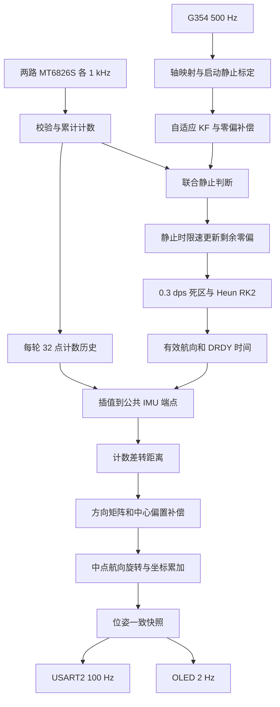

# IMU 与双随动轮平面定位：算法与标定详细说明

本文件说明 STM32F407、G354 与双 MT6826S 平面定位工程的处理模型、数值约定、标定步骤和误差边界。配置值对应当前源码；概要见 [定位概览](planar_localization_study.md)，接口与状态见各模块 README。

## 1. 系统结构

独立贴地的两只从动全向轮测量不同方向的滚动距离，G354 提供航向。两轮距离和航向在公共时间端点对齐后，经安装几何补偿和坐标旋转得到底盘中心的 X、Y。

| 环节 | 当前实现 |
| --- | --- |
| IMU 采集 | SPI3、DRDY 通知，标称 500 Hz |
| 编码器采集 | SPI1/PA4、SPI2/PB12，各 1 kHz，独立收发 DMA |
| 姿态处理 | 三轴自适应标量 KF、零偏补偿、联合静止检测、死区、Heun RK2 |
| 位姿处理 | 计数历史插值、方向矩阵、交点偏置补偿、中点航向积分，标称 500 Hz |
| 串口输出 | USART2，115200、8N1，100 Hz ASCII 位姿与有效性 |
| OLED | SSD1306 128×64，I2C3，8×16 等宽字体，500 ms 刷新 |

定位主要依赖轮地接触和相对航向。两只测量轮不能在一般平面运动下独立提供 X、Y、Yaw 三个自由度，也不提供地理北向或绝对位置。

### 1.1 三层职责

| 层 | 职责 | 典型文件 |
| --- | --- | --- |
| bsp | 总线、片选、DMA、中断通知和公共时间 | `bsp_g354.*`、`bsp_mt6826s.*`、`bsp_time.*` |
| modules | 协议、滤波、标定、计数展开和几何积分 | `attitude/`、`gyro_temperature.*`、`encoder_motion/`、`odometry/` |
| application | 周期调度、历史同步、配置、重置和一致快照 | `imu_app.*`、`encoder_app.*`、`odometry_app.*` |

串口和 OLED 通过 `odometry_app_get_output()` 获取同一套位姿及有效性。显示、发送任务不参与坐标积分。

### 1.2 数据流程



## 2. 坐标、单位和姿态约定

机体系 b 固连底盘：+X 向前、+Y 向左、+Z 向上，俯视逆时针航向为正。世界坐标系 n 固定在建立里程计原点的位置，初始底盘朝向对应世界 +X。

IMU 四元数分量为 `[w,x,y,z]`，采用 Hamilton 乘法，表示机体到开机参考系的主动旋转。初始值为 `[1,0,0,0]`，三轴角度均从零开始。加速度计用于标定和静止检测，没有持续参与姿态反馈，因此 Roll/Pitch 也会累积陀螺仪误差。

欧拉角顺序为 `R=Rz(yaw)*Rx(roll)*Ry(pitch)`。Roll 范围约为 ±90°，Pitch/Yaw 约为 ±180°。Roll 接近 ±90° 时存在欧拉奇异性，应使用四元数分析复合姿态。

| 量 | 单位 |
| --- | --- |
| 角速度、零偏 | °/s，代码中为 dps |
| 加速度 | g |
| 温度 | ℃ |
| 坐标、轮径、安装位置 | mm |
| 对外姿态、方向角配置 | ° |
| 三角函数及几何公式内角增量 | rad |
| 公共采样时间 | μs，32 位 TIM2 |

安装轴映射应对角速度和加速度使用同一右手变换。IMU 应刚性固定；本平面模型要求其轴映射后的 Z 轴与底盘竖直方向一致。仅使用角速度与轮距计算位置时，不需要把 IMU 安装点当作测量轮参考点。

## 3. 启动标定

### 3.1 上电流程

1. G354 复位保持至少 100 ms，释放后等待至少 800 ms，再检查就绪、诊断及产品信息。
2. 写入并回读 SPI 采样配置，启动 500 Hz 数据输出。
3. 丢弃 50 个过渡样本，约 0.1 秒。
4. 连续采集 1000 个合格静止样本，约 2 秒，计算每轴启动均值、样本方差和平均温度。
5. 初始化滤波器、四元数与偏置状态，发布有效姿态。里程计等待首个具备两轮插值样本的公共端点，再建立原点。

正常约 3 秒就绪。期间保持整机静止，直到屏幕显示 `ODOM RUN E0`；若采集因运动、噪声或输入异常重启，等待时间会增加。启动标定完成不代表器件已热稳定。

### 3.2 重启采集的条件

| 检查 | 当前门限 |
| --- | --- |
| 任意轴原始角速度绝对值 | 超过 0.5 °/s |
| 加速度模长与 1g 的差 | 超过 0.05g |
| 任意轴加速度与已采样均值之差 | 超过 0.03g |
| 收满后任意轴角速度标准差 | 超过 0.05 °/s |
| 收满后任意轴加速度标准差 | 超过 0.01g |

不合格时清空已采样计数，重新累积。观察 `g_imu.calibration_samples` 与 `calibration_restarts` 可区分正常采集和反复重启。启动标定不使用编码器轮速作为门限，低于阈值的恒定慢转仍可能污染启动零偏，必须实际停稳。

### 3.3 均值和方差

对某轴 N 个静止角速度样本 z：

```text
b_start = mean(z)
R = sum((z-b_start)^2)/(N-1)
```

均值估计启动偏置，方差描述观测噪声。两者作用不同。当前各轴 R 独立，正下限为 `1e-8 dps²`；滤波器初始状态取启动均值，P 与 Q 均以 R 初始化。

## 4. 自适应角速度卡尔曼滤波

### 4.1 单轴模型

每轴使用随机游走模型，状态转移和观测系数均为 1。各轴独立执行：

```text
x_pred = x_previous
P_pred = P_previous + Q_previous
innovation = z - x_pred
K = P_pred/(P_pred + R)
x = x_pred + K*innovation
P = max((1-K)*P_pred, R*1e-6)
```

新息为测量减去预测值。最近 10 个新息平方用于估计下一周期的过程噪声：

```text
C = mean(recent_innovation_squared)
Q_next = clamp(K*K*C, 0.01*R, 1e6)
```

窗口未满时使用已有样本。Q 保留正下限，避免长时间静止后滤波增益过低。R 在一次运行中保持启动估计值。

### 4.2 实际作用

KF 降低角速度噪声，但不会自动区分新息来自噪声还是真实转动，也不会代替偏置补偿。评估时应同时观察平滑程度、动态延迟、正反转响应和积分面积。当前 KF 没有把 X、Y、Yaw 作为统一的位姿状态估计。

## 5. 零偏、温度和运行静止检测

### 5.1 补偿分工

```text
b_total = b_start + b_temperature + b_residual
omega_compensated = omega_filtered - b_total
```

启动项来自开机静止均值，温度项描述相对启动温度的变化，剩余项仅在运行中确认静止后限速更新。避免重复扣除温度拟合截距或同一段偏置。

### 5.2 温度模型

当前温度模型默认关闭。启用时，每轴使用实测斜率 a：

```text
T_used = clamp(T, T_min, T_max)
T_start_used = clamp(T_start, T_min, T_max)
b_temperature = a*(T_used-T_start_used)
```

启动均值已包含启动温度的偏置，因此无需再次扣除线性拟合截距。超出实测温区时模型钳制到边界，并输出超温区标志，不向外外推。

### 5.3 联合静止判据

| 信号 | 当前条件 |
| --- | --- |
| KF 后、偏置补偿后、死区前角速度 | 各轴绝对值不超过 0.04 °/s |
| 原始角速度扣除偏置后 | 各轴绝对值不超过 0.5 °/s，防止滤波滞后掩盖刚发生的运动 |
| 加速度模长 | 距 1g 不超过 0.03g |
| 编码器端点变化 | 每轮约 5 ms 端点间变化不超过 8 count |
| 编码器窗口范围 | 至少 100 ms 的最大累计计数减最小累计计数不超过 40 count |
| 输入健康 | 两轮正常、连续且未过期，IMU 不过量程 |
| IMU 静止持续时间 | 上述条件连续满足约 100 ms |

轮子每个健康样本也参与端点变化检查；窗口用计数范围避免正反运动相互抵消。轮子离地、空转或打滑时，“编码器没动”不等于底盘静止。静止检测仍有有限分辨能力。

### 5.4 剩余零偏更新

确认静止后，对每轴进行：

```text
target = omega_filtered - b_start - b_temperature
step = 0.02*dt
b_residual += clamp(target-b_residual, -step, step)
```

斜率单位为 `(°/s)/s`；在 500 Hz、dt=0.002 s 时，每次最大变化为 0.00004 °/s。运动或任一静止条件失败时停止更新。该过程修正后续积分输入，不会自动撤销之前积累的航向误差。

### 5.5 角速度死区

三轴分别对绝对值判断，当前暂用门限为 0.3 °/s：

```text
omega_integrated = 0,                 abs(omega_compensated) < 0.3
omega_integrated = omega_compensated, otherwise
```

静止判据必须使用死区前数据。0.1 °/s 持续转动 60 秒实际为 6°，可能被当前死区抑制。静止角度不动不能单独证明零偏已经消除，需要同时查看 `compensated_gyroscope_dps` 和偏置项。

## 6. Heun 二阶 RK 四元数积分

先把角速度由度/秒转为弧度/秒。令四元数为 q，角速度纯四元数为 `[0,wx,wy,wz]`，使用：

```text
f(q,w) = 0.5*q ⊗ [0,wx,wy,wz]
k1 = f(q_previous,w_previous)
q_pred = q_previous + dt*k1
k2 = f(q_pred,w_current)
q = q_previous + dt*(k1+k2)/2
q = q/length(q)
```

导数定义中的 1/2 与两段导数求平均的 1/2 分别保留。首个有效点只保存角速度，不积分未知的前一段时间。当前 dt 使用配置采样率的倒数，IMU 应用层负责拒绝缺帧和不连续时序。

### 6.1 ZXY 欧拉角提取

```text
roll  = asin(clamp(2*(w*x+y*z), -1, 1))
pitch = atan2(2*(w*y-x*z), w*w-x*x-y*y+z*z)
yaw   = atan2(2*(w*z-x*y), w*w-x*x+y*y-z*z)
```

结果由弧度转换为度。atan2 保留完整象限，asin 限幅避免浮点舍入越界。欧拉顺序不同的角度不能逐项直接比较。

## 7. 编码器展开、距离与转速

当前每圈计数 N=32768。相邻有效单圈角度差经半圈规则展开：

```text
delta = current_count - previous_count
delta > N/2  => delta -= N
delta < -N/2 => delta += N
```

相邻有效采样之间的真实转动必须严格小于半圈。缺失了整圈或高速混叠时，单圈绝对角无法恢复真实运动。坏帧、报警、重置和超时应传播连续性状态。

第 i 路距离换算为：

```text
mm_per_count_i = direction_i*pi*D_i/(N*gear_ratio_i)
ds_i = mm_per_count_i*delta_counts_i
```

`gear_ratio_i` 为编码器圈数/轮子圈数，直连为 1；`direction_i` 为 +1 或 -1。58 mm 轮径对应约 182.212 mm/圈，单计数约 0.00556 mm。这是名义分辨率，不是定位精度。

转速使用至少 10 ms 的位移窗口和 20 ms 时间常数低通。定位使用累计计数差，不通过滤波 RPM 再积分距离，避免把测速滤波滞后引入位置。

## 8. 公共时间端点和插值

### 8.1 时间来源

三路共享 1 MHz、32 位 TIM2，运行中不重置。IMU 时间来自有效 Burst 对应的 DRDY，编码器时间标记角度读取请求的 CS 附近。约 71.6 分钟回绕一次；使用短窗口时间差处理回绕。

同一个结构体的一致快照不代表多个传感器同一时刻采样。G354 与 MT6826S 内部滤波和计算延迟仍需独立评估。

### 8.2 计数插值

对公共 IMU 时刻 t，找到每轮包围它的样本 `(t0,c0)`、`(t1,c1)`：

```text
lambda = (t-t0)/(t1-t0)
c(t) = c0 + lambda*(c1-c0)
```

实现保留整数计数锚点与短区间小数部分，避免长期大累计值先转浮点损失精度。每轮保留 32 点历史，航向队列保留 16 点。不外推。

### 8.3 恢复边界

| 边界 | 当前值 |
| --- | --- |
| 每轮插值前后样本最大跨度 | 4 ms |
| 待处理端点延迟上限 | 小于 8 ms |
| 相邻成功定位端点间隔上限 | 6 ms |
| 输出过期判断 | 达到 10 ms |

短暂跨度过大可跳过中间端点，保留上一成功端点、累计计数和连续航向。后续端点仅在输入代次一致且满足全部边界时恢复。跳过端点不等于丢弃两端之间的累计位移，但较长步长会增大动态近似误差。

真实输入间断、计数重置、队列溢出或超过恢复边界时锁存跟踪丢失。传感器重新健康不代表找回了遗漏运动。

## 9. 轮子方向和中心偏置

### 9.1 一般平面测量模型

第 i 个轮子的滚动正方向角为 alpha_i，轮子测量点相对底盘参考点 O 的位置为 `(x_i,y_i)`。小增量满足：

```text
ds_i = cos(alpha_i)*dx_O + sin(alpha_i)*dy_O
       + (-y_i*cos(alpha_i)+x_i*sin(alpha_i))*dtheta
```

其中 dtheta 为弧度。该式来自平面刚体速度投影，前提是测量轮可靠贴地且沿滚动方向不打滑。

### 9.2 当前交点模型

当前配置使用两条滚动直线交点 C，相对底盘中心 O 的位置为 `(cx,cy)`。将 C 作为测量方向矩阵的参考点：

```text
H = [[cos(alpha_1), sin(alpha_1)],
     [cos(alpha_2), sin(alpha_2)]]
[dx_C,dy_C]^T = inverse(H)*[ds_1,ds_2]^T
dx_O = dx_C + cy*dtheta
dy_O = dy_C - cx*dtheta
```

当轮子测量点沿其滚动直线移动时，转动投影项不变，因此可用两条直线交点统一表达偏置。两轮方向不必精确 90°，但夹角接近平行时矩阵病态。`det(H)=sin(alpha_2-alpha_1)`，当前拒绝绝对值小于 0.1 的配置。

测量矩阵并不总是正交矩阵，不能无条件用转置代替逆矩阵。

### 9.3 当前名义几何

```text
alpha_1 = 0 deg      alpha_2 = 90 deg
D_1 = D_2 = 58 mm    gear_ratio_1 = gear_ratio_2 = 1
direction_1 = direction_2 = +1
cx = -20 mm         cy = +20 mm
dx_O = ds_1 + 20*dtheta
dy_O = ds_2 + 20*dtheta
```

交点位于底盘中心后方 20 mm、左方 20 mm。底盘绕 O 原地旋转时，两轮均可能有非零读数，补偿后的 O 应基本不移动。底盘驱动轮的 45° 布置不改变这里的机体系定义。

## 10. 世界坐标积分

航向增量先处理回绕，再取区间中点：

```text
dtheta = wrap_to_pi(yaw_now-yaw_previous)
theta_mid = previous_relative_yaw + dtheta/2
dX = cos(theta_mid)*dx_O - sin(theta_mid)*dy_O
dY = sin(theta_mid)*dx_O + cos(theta_mid)*dy_O
X += dX
Y += dY
```

例如 +179° 到 -179° 应得到 +2° 增量，不能直接把两个显示角平均成 0°。当前相对航向在 ±180° 附近回绕，不是多圈角度。

机器人可以侧移，机头方向不等于运动方向，应同时保留 dx_O、dy_O。中点积分是短周期近似，高角加速度、内部延迟和较长步长都会影响轨迹。

## 11. 机械测量与标定

### 11.1 定义基准

在底盘上标出中心 O、+X 和 +Y。轮子处于正常压紧、承载状态时，沿每只测量轮的滚动方向画出直线。两线交点为 C，测量其相对 O 的有符号坐标。

方向角从底盘 +X 沿逆时针方向量到轮子滚动正方向；不要测成轮轴方向。确认向前滚动对应 SPI1 正计数、向左对应 SPI2 正计数，否则修改方向符号。两方向角分别测量，不能仅凭夹角推定安装绝对朝向。

### 11.2 有效轮径

固定底盘朝向，沿某轮滚动方向移动独立测得的距离 L，记录其累计计数差 delta_c。直连且方向已确认时：

```text
D_effective = abs(L)*N*gear_ratio/(pi*abs(delta_c))
```

或按距离比修正 `D_new=D_old*L_reference/L_estimated`。正反向、多次、不同长度测量；轮子压缩、载荷和地面会改变有效直径。避免同时调整轮径、方向角和偏置后无法区分误差来源。

### 11.3 方向角和偏置

使用两条已知方向的直线运动检查交叉轴误差，再用顺逆时针原地旋转检查底盘中心的虚假平移。轮径和航向比例先确认，随后调整方向角和 `(cx,cy)`。改变方向角后交点位置也应对应实际滚动直线。

若做最小二乘标定，可使用每段已知运动的 `dx_O,dy_O,dtheta` 与测量 `ds_i` 建立投影模型。需要有方向和旋转变化的样本，以区分轮径比例、方向误差及偏置；单一方向运动可能无法辨识全部参数。

## 12. 温漂与低速标定

### 12.1 温度采集与拟合

1. 固定实际安装和供电条件，保持两轮健康、静止，等待 IMU 有效。
2. 向 `g_imu_command` 写 1，开始采集；确认命令成功。
3. 每 0.5℃ 区间收集一组连续 500 点静止角速度均值，最多 32 组。
4. 至少 7 组且温差达到 3℃ 后写 2，拟合各轴 `bias=a*T+c`。
5. 检查斜率、残差和升降温重复性；需要应用时写 3。
6. 写 4 可停止。跨上电保存需将斜率和实测温区填入配置并重新编译。

拟合使用 KF 后、尚未扣除偏置的角速度。标定点只保存在 RAM，命令不擦写 Flash。启动均值与相对温度项共同使用，不重复扣拟合截距。详细字段与限制见 [姿态模块说明](../modules/attitude/README.md)。

### 12.2 死区和角速度比例

在热稳定及多个温度点分别采集死区前的静止残余，统计均值、标准差、分位数和尖峰。同时利用转台测量正反方向、多个速度、多个已知角度。

先确定必须保留的最小真实角速度，再评估静止噪声与死区的冲突。若噪声与慢转重叠，应改善温漂、振动或偏置估计，不能仅靠增加死区。手动转动可检查方向与响应，不适合作为精确角速度基准。当前暂用 0.3 °/s，待转台标定。

## 13. 输出、状态与异常

USART2 报文为：

```text
$ODOM,seq,t_us,x_mm,y_mm,yaw_deg,valid,continuous,state,error*HH\r\n
```

校验是 `$` 与 `*` 之间的逐字节 XOR。正常状态尾部为 `1,1,1,0`。同步恢复等待可为 `0,1,0,5`，跟踪丢失则为 `valid=0,continuous=0,state=2`。接收端还需判断断流、时间戳及校验；串口速率不等于积分速率。

OLED 每 500 ms 显示状态、X、Y 和 Yaw，数值一位小数并右对齐；无效时显示 `--`。屏幕可能在通信中断后保留最后画面，实时控制应使用串口有效性与超时判断。

| 变量 | 主要用途 |
| --- | --- |
| `g_imu.state / valid / tracking_continuous` | 启动状态、姿态有效性及连续性 |
| `g_imu.compensated_gyroscope_dps` | 死区前残余角速度 |
| `g_imu.stationary / bias_updates` | 联合静止判据与运行零偏更新 |
| `g_encoder / g_encoder2` | 两路计数、CRC、报警、DMA 和实际采样频率 |
| `g_odometry.state / error / valid` | 当前定位状态 |
| `g_odometry.updates / timestamp_us` | 坐标是否继续更新 |
| `g_odometry.skipped_sync_samples / sync_recoveries` | 同步拒绝与恢复统计 |
| `g_telemetry.tx.errors / timeouts` | 串口传输异常 |
| `g_display.ready / error / frames` | 屏幕连接和刷新状态 |

`odometry_app_reset()` 请求建立新的独立原点，不补回旧轨迹。IMU 姿态连续性已丢失时，当前实现需要重启并静止标定。

## 14. 验收和误差边界

| 项目 | 记录内容 |
| --- | --- |
| 长时静止 | X/Y/Yaw、温度、死区前角速度、偏置、错误计数及输出时间连续性 |
| 正反直线 | 已知距离、方向符号、比例误差与交叉轴位移 |
| 原地旋转 | 独立参考角度、顺逆转误差、中心 X/Y 残差 |
| 矩形闭环 | 路段误差、独立测得的终点位置及航向误差 |
| 连续运行 | 采样间隔、同步恢复次数、串口有效性和断流 |

轮径误差通常随距离放大，航向误差会把位移投影到错误方向。例如沿直线移动 10 m，若存在恒定 1° 航向偏差，横向误差约为 `10*sin(1°)=0.175 m`。安装偏置误差主要在转弯时体现，打滑、测量轮离地和内部延迟会产生额外误差。

坐标误差应由独立基准评估，不能用被测系统自身坐标证明精度。程序编译、接口联通、静止不漂和实际动态定位精度是不同的验收项目。

当前仍待装车确认两轮方向符号、有效轮径、实际方向角和交点偏置；温度模型默认关闭，角速度死区暂用。后续可基于实测结果评估分段温度模型、传感器延迟补偿、SE(2) 区间积分或外部位置/航向约束，尚未实现的功能不计入当前能力。
