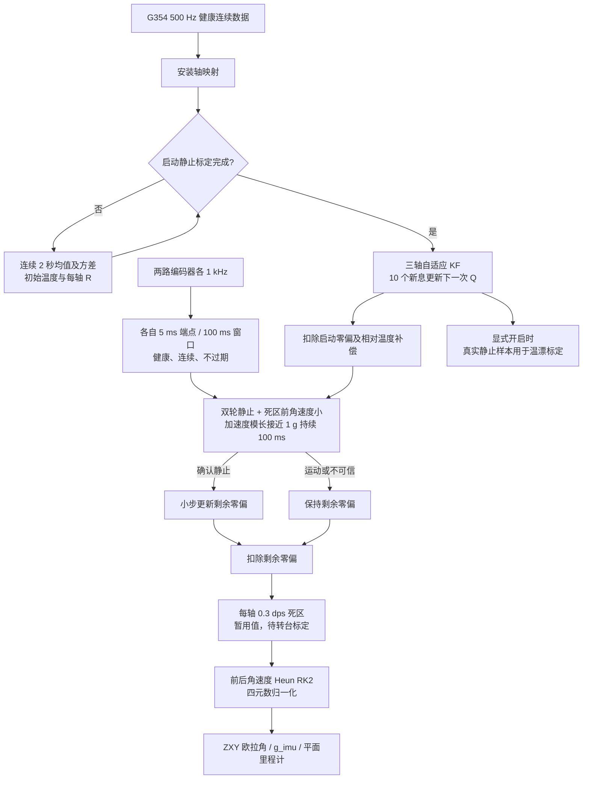

# 论文方法的 G354 姿态解算

2026-10-31 起，固件使用王厚伟论文第 3 章及第 4.2 节的方法替换 Fusion：三轴新息自适应标量 KF、启动零偏、相对温度补偿、陀螺仪与双编码器联合静止识别、渐进零偏修正、角速度死区、二阶 Runge-Kutta 四元数积分及归一化。标称频率仍是 500 Hz。

这是对论文方法的工程实现。论文缺失的初值、数值保护、判据顺序和公式歧义按以下约定补全。尚未做本版上板验证，不承诺复现论文精度。

当前按用户选择设置 `IMU_GYRO_DEADBAND_DPS=0.3f`，三轴分别使用 0.3 dps 死区，之后有转台再标定。这是暂用值，不是本机已标定值。下文 0.15 dps 为论文参考值。

## 分层和处理流程

- `bsp`：继续负责 G354 SPI3、DRDY、编码器 SPI1/SPI2 DMA 和公共 TIM2。
- `modules/attitude/attitude.*`：KF、各级补偿、静止判别、RK2、欧拉角，不依赖 HAL/RTOS。
- `modules/attitude/attitude_wheel_gate.*`：基于实际时间的编码器静止窗口，不依赖 HAL/RTOS。
- `modules/attitude/gyro_temperature.*`：温度分箱、原始零偏均值、最小二乘直线拟合，不依赖 HAL/RTOS。
- `application`：传感器健康检查、任务间一致快照、启动标定、参数与命令、结果发布。

## 与原 Fusion 的输出差别

初始四元数为 `[1,0,0,0]`，开机姿态定义为导航参考姿态，三轴角度初始均为 0。它不再通过加速度计测量初始绝对倾角；加速度计只用于标定与静止安全判据，不参与持续姿态纠正。因此 Roll/Pitch 也会累积陀螺仪误差。

四元数采用 `[w,x,y,z]`、Hamilton 乘法、机体到初始导航系的主动旋转。三轴输出采用论文的 Z-X-Y 顺序 `R=Rz(yaw)*Rx(roll)*Ry(pitch)`；符号统一为本工程既有的右手系，平面逆时针 yaw 为正。`roll_deg` 范围 ±90°，`pitch_deg` 和 `yaw_deg` 范围 ±180°。与上一版 ZYX 在复合倾斜时数值不同，X 转角接近 ±90° 时存在欧拉奇异性。倾斜车体应按四元数分析；平面使用时要水平安装。

`accelerometer_ignored=1` 是该算法的预期状态，不是故障；`recovering=0`，没有 Fusion 的加速度/启动恢复状态机。`max_fusion_time_us` 保留旧字段名称，现在统计新姿态更新与温漂采集的最长耗时，不含单次显式拟合命令。

## 参数与论文原式的差异

参数集中于 `application/imu_config.h` 和 `application/encoder_config.h`。

| 项目 | 本实现 |
| --- | --- |
| 启动标定 | 先等待约 100 ms，再采集连续 1000 点（2 秒）；移动或不合格方差会重启采集 |
| KF 的 R | 启动静止原始角速度的样本方差，每轴独立，正下限 1e-8 dps² |
| KF 的 Q | 最近 10 个预测新息平方的均值乘 K²，作用于下一周期；窗口未满用已有样本；Q 下限 0.01R，防止长静止后增益塌陷 |
| 静止角速度 | 各轴 KF 后、所有偏置补偿后、死区前绝对值 <=0.04 dps，连续约 100 ms |
| 额外保护 | 加速度模长距 1 g 不超过 0.03 g；原始补偿角速度超过 0.5 dps 立即禁止学习 |
| 两轮静止 | 原论文 4096 count/rev；本机 32768 count/rev，按 8 倍换算，真实约 5 ms 端点间变化 <=8 count，至少 100 ms 窗口最大值减最小值 <=40 count |
| 防止运动抵消 | 每个 1 ms 健康样本也检查距端点的变化；使用整个窗口计数范围，避免原文带符号求和正负抵消；5 ms 无数据或任何错误/重置会阻塞 |
| 剩余零偏更新 | 每次静止更新限幅至 `0.02 dps/s * dt`；500 Hz 下最多 0.00004 dps/次，可正负更新，不越过该样本目标 |
| 死区 | 论文参考 0.15 dps；当前按用户选择 `IMU_GYRO_DEADBAND_DPS=0.3f`，各轴绝对值小于门限则归零 |
| RK2 | `k1=f(q_prev,w_prev); q_pred=q_prev+dt*k1; k2=f(q_pred,w_now); q=q_prev+dt*(k1+k2)/2`，每步归一化 |

论文把渐进步长写为“0.0001 度”，角速度单位和更新关系不充分。本实现明确把它解释为论文 200 Hz 下每次 0.0001 dps，再换算为时间斜率；这是工程选择，不是原文唯一可推导的值。

论文式 (4.9) 对已含 dt/2 的两段增量直接相加，与通用 RK2 式 (4.3) 有比例疑点。本实现使用标准 Heun 平均两段导数，保留四元数运动学的 1/2，避免转角翻倍。用 atan2 保留象限，并限制 asin 输入。

**死区会吞掉真实慢转。** 例如 0.1 dps 转动 60 秒对应 6°，该设置可能基本不输出。静止时 yaw 不动不能单独证明真实零偏改善，需要同时观察死区前数据和偏置。

两轮故障时姿态仍可由陀螺仪继续传播，但禁止学习新的剩余零偏。两轮需正常贴地；离地或空转时“轮子没动”不能证明底盘静止。窗口判据不能严格区分任意微小的恒定运动。

G354 丢帧、超时、跨周期读取或过量程后仍锁存 `tracking_continuous=false`，不恢复为有效完整轨迹。清除 RK2 前一角速度、KF 新息和静止计时，下一有效点重新锚定滤波状态，不积分未知区间；重启并重新标定建立新参考。

论文第 3.3.3 节另有针对特定振动频率的谐波拟合、归零/缩放方案。本版未加入该部分：需要实测底盘频谱与旋转工况，不能直接将论文 48 Hz 和缩放 0.4 套用到 G354。

## 调试变量

继续观察 `g_imu.roll_deg / pitch_deg / yaw_deg / quaternion`。新增字段：

| 字段 | 含义或预期 |
| --- | --- |
| `algorithm` | 1：论文 KF + RK2 |
| `state / valid / tracking_continuous` | 健康运行通常为 2 / 1 / 1 |
| `stationary` | 两轮健康且确认静止后为 1；陀螺静止确认在两轮窗口完成后另需约 100 ms |
| `stationary_block_mask` | 可叠加：1 角速度、2 加速度、4 编码器1、8 编码器2；0 表示本次判据均通过，还需等待静止时间 |
| `stationary_time_s` | 连续符合判据的时间，封顶约 0.1 s |
| `bias_updates` | 静止时持续增加，运动或任何判据不通过时停止增加 |
| `gyroscope_dps[3]` | 映射后的原始角速度 |
| `filtered_gyroscope_dps[3] / kalman_gain[3]` | KF 输出及增益 |
| `startup_gyroscope_bias_dps[3] / kalman_noise_variance[3]` | 启动均值与方差 |
| `temperature_bias_dps[3] / residual_bias_dps[3]` | 温度项与运行中渐进修正项 |
| `gyroscope_bias_dps[3]` | 上述三项补偿之和 |
| `compensated_gyroscope_dps[3]` | 死区前角速度，判断实际残余漂移应看它 |
| `corrected_gyroscope_dps[3]` | 死区后，用于姿态积分的角速度 |
| `deadband_mask` | bit0/1/2 表示 X/Y/Z 被死区归零；静止常见 7 |
| `temperature_compensated` | 是否启用实测温度模型；默认 0 |
| `temperature_out_of_range` | 当前或启动温度超出模型实测温区；补偿会钳制到边界，不外推 |

## G354 温漂标定步骤

当前没有该 G354 的标定数据，因此默认 `IMU_TEMPERATURE_MODEL_VALID=0`。代码不会把零系数报告为“已标定”。采用同一芯片实测数据后，再启用一次温度模型。

1. 在实际安装、供电和滤波条件下，固定整机并保持两轮健康、静止。尽量从较低温的自然上电升温过程开始，先等 `g_imu.valid=1`。
2. 向单次命令邮箱 `g_imu_command` 写 **1**，或任务调用 `imu_app_request_command(IMU_COMMAND_TEMPERATURE_START)`。任务消费后自动清零邮箱；检查 `last_command=1, command_succeeded=1`。
3. 观察 `g_imu.temperature_calibration`。`collecting=1` 时只收集 `stationary=1` 的 **KF 后原始角速度**，不使用已经扣零偏或归零的数据。每个 0.5℃ 区间记录一组连续 500 点均值（约 1 秒），同一区间不重复记录；运动/输入异常会清除未完成的点。最多 32 点，覆盖升温和降温时仍不能重复采同一区间。
4. `points>=7` 且 `max_c-min_c>=3.0℃` 后，写命令 **2**（拟合）。`command_succeeded=1`、`fit_valid=1` 表示得到 `slope[3]`、`intercept[3]`、`rms_dps[3]`。温区不足时返回失败并保持采集；不能强行补造系数。自然温升小于 3℃ 时本次无法完成默认拟合条件。
5. 检查拟合残差与升降温重复性。需要应用本次系数时写命令 **3**；`applied=1` 且 `temperature_compensated=1` 后生效。运行中应用时会重分配温度项与剩余零偏，避免角速度因重复补偿突跳。该状态并不证明该曲线在其他工况同样有效。
6. 命令 **4** 可停止采集。重发命令 1 会清除本次采集与拟合结果，已生效的姿态模型仍保留到重新应用或重启。
7. 需要跨上电保存时，将 `slope[0..2]` 及实测 `min_c/max_c` 填入 `imu_config.h` 对应宏，把 `IMU_TEMPERATURE_MODEL_VALID` 改为 1 后重新编译、烧录。初始偏置来自本次启动均值，温度项只计算 `slope*(T-T_start)`，不用再次扣拟合截距。

本版标定点位于 RAM，命令不擦写 MCU Flash。论文把点存入 Flash；本工程当前链接布局没有预留参数扇区，直接擦写 STM32F407 扇区可能覆盖程序，所以先采用配置常量保存经确认的系数。换轴映射、供电、设备或标定温区后需重新评估。

## 构建状态

本版仅进行了固件编译和源码复核，未执行测试或烧录。`tests/imu_regression.*` 是旧 Fusion 版本的历史回归用例，与新的姿态接口不兼容，不代表本版算法已通过回归。
