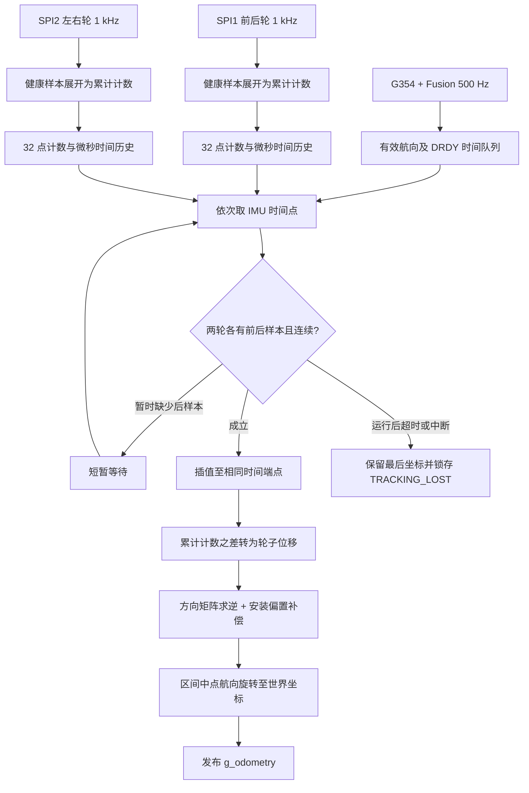

# 双随动轮平面里程计（第一版）

输入为两个 MT6826S 的累计计数，以及 G354 / Fusion 的航向。输出为底盘中心的平面坐标和相对航向。启动时保持静止，等待 IMU 标定及姿态恢复完成；选取第一个具备两轮前后样本的 IMU 时间点作为零点。该时刻底盘中心为 `(0,0)`，朝向为 `0°`。此前的运动不计入轨迹。

## 接线、坐标和参数

| 参数 | 第一版设置 |
| --- | --- |
| 前后测量轮 | SPI1 / PA4，`g_encoder`，滚动方向 0° |
| 左右测量轮 | SPI2 / PB12，`g_encoder2`，滚动方向 90° |
| 两轮直径 | 各 58 mm |
| 每圈计数 | 32768 |
| 编码器圈数 / 轮子圈数 | 各 1，默认直接连接 |
| 两条滚动方向延长线交点 C | 相对底盘中心 O，`cx=-20 mm, cy=+20 mm`，即后方 20 mm、左方 20 mm |
| 坐标 | +X 向前，+Y 向左，逆时针航向为正 |
| 世界坐标 | 原点在启动参考位置，+X 沿启动朝向，+Y 朝启动时左方 |

参数集中在 `application/odometry_config.h`。轮子方向符号暂设为 `+1`，尚未通过装车运动确定。轮子向车体正前方滚动时，前后轮累计计数应增加；向车体左侧滚动时，左右轮累计计数应增加。若相反，把对应的 `ODOMETRY_WHEEL_n_DIRECTION` 改成 `-1`。旋转底盘逆时针时，IMU yaw 应增加；IMU 安装轴映射仍由 `imu_config.h` 管理。

这里的角度是**轮子滚动正方向与底盘 +X 的夹角**，不是轮轴角度。底盘驱动轮的 45° 安装不增加额外坐标旋转。实际角度和偏置测量后再替换配置；改变方向角后，C 必须仍是对应实际滚动直线的交点。

## 分层与流程

- `bsp/bsp_time.*`：共享 TIM2 的 1 MHz 连续时钟，幂等启动，运行中不清零。
- `bsp/bsp_mt6826s.*`：记录普通采样 CS 下降沿附近的微秒时间。
- `application/odometry_app.*`：固定容量历史、时间对齐、任务、错误锁存和一致性发布。
- `modules/odometry/odometry.*`：无 HAL / RTOS 依赖的几何计算。



两轮仍按标称 1 kHz 采集。里程计依次处理每个有效 IMU 端点，标称更新率为 500 Hz；任务每 1 ms 唤醒，等待编码器后侧样本通常会产生约 1～数 ms 延迟。观察 `measured_update_rate_hz` 确认实际频率。

## 时间对齐的边界

三路均使用 TIM2 时间。IMU 使用与有效 Burst 对应的 DRDY 时间，编码器使用角度读取请求的 CS 时间；记录 CS 时间后才进行诊断访问，避免诊断片选覆盖采样时间。这里只对齐软件可观测的采样时间，没有补偿 G354 内部滤波、MT6826S 内部计算及滤波产生的延迟，动态精度需要装车确认。

每轮保留 32 个健康计数样本，航向队列保留 16 点。必须存在包围目标时间的两个编码器样本；相邻样本最大跨度为 4 ms，不外推。等待超过 8 ms、IMU 端点间隔超过 6 ms、航向队列溢出、输入被拒绝或编码器累计计数被单独重置，都会使已建立的轨迹失效。静态存储、任务临界区复制，不阻塞传感器任务等待同步。

时间差使用短窗口内的无符号差值，正常跨越约 71.6 分钟一次的 TIM2 回绕。计数插值保留整数锚点，仅转换短区间的计数差，避免长期累计计数先转浮点造成精度损失。数学模块保守拒绝单次更新超过一圈的整数锚点变化；历史插值拒绝相邻锚点差达到半圈。编码器本身仍要求实际相邻采样运动严格小于半圈，更快运动可能产生无法检测的混叠。

## 几何公式

令 `alpha_i` 为滚动正方向角，`ds_i` 为有符号滚动距离，`dtheta` 为经过 ±180° 回绕处理后的航向增量，单位为弧度。

```text
ds_i = delta_counts_i × direction_i × π × diameter_i / (32768 × gear_ratio_i)

H = [ cos(alpha_1)  sin(alpha_1) ]
    [ cos(alpha_2)  sin(alpha_2) ]

[dx_C, dy_C]^T = inverse(H) × [ds_1, ds_2]^T
dx_O = dx_C + cy × dtheta
dy_O = dy_C - cx × dtheta

theta_mid = previous_relative_yaw + dtheta/2
dX = cos(theta_mid) × dx_O - sin(theta_mid) × dy_O
dY = sin(theta_mid) × dx_O + cos(theta_mid) × dy_O
X += dX, Y += dY
```

目前 `0°/90°`、`cx=-20, cy=+20` 时：`dx_O = ds_1 + 20*dtheta`，`dy_O = ds_2 + 20*dtheta`。纯原地旋转时，两轮都存在由偏置引起的读数，补偿后底盘中心应基本不移动。矩阵行列式绝对值小于 0.1 时拒绝配置，避免接近平行的滚动方向使误差放大。

这是按短时间步长进行的中点近似积分，无 EKF，没有绝对航向或位置观测。IMU yaw 漂移、轮径误差、打滑、机械不垂直和传感器延迟仍会影响最终轨迹。

## 调试字段与接口

| 字段 | 含义 |
| --- | --- |
| `g_odometry.x_mm / y_mm` | 底盘中心世界坐标，毫米，double |
| `g_odometry.yaw_deg` | 相对初始朝向的航向，约 -180°～180° |
| `g_odometry.state` | WAITING=0、RUNNING=1、TRACKING_LOST=2、ERROR=3 |
| `g_odometry.error` | NONE=0、TASK=1、CONFIG=2、TIMEBASE=3、INPUT=4、SYNC=5、GEOMETRY=6 |
| `valid` | 当前发布结果可用；消费者还应通过 getter 检查时效 |
| `tracking_continuous` | 从零点到当前是否保持完整，缺失后锁存为 false |
| `timestamp_us` | 最近坐标对应的共同端点时间 |
| `latency_us` | 处理该端点时的延迟 |
| `encoder_bracket_us[2]` | 本次两轮插值前后样本的跨度 |
| `updates / measured_update_rate_hz` | 更新次数、约每秒更新的实际处理频率 |
| `wait_reason` | NONE=0、等待有效 IMU=1、前后轮历史为空=2、左右轮历史为空=3、等待匹配的连续同步样本=4 |
| `task_cycles` | 里程计任务循环计数，在等待建立原点时也会增加 |
| `lost_input_mask` | 第一次输入失效来源位图：1=SPI1，2=SPI2，4=IMU；多路可叠加，直到重建原点 |
| `sync_failure / sync_input_mask` | 同步失效具体原因与来源，定义见下表 |
| `failure_age_us` | 锁存失效时待处理端点的延迟 |
| `failure_interval_us` | 锁存失效时待处理 IMU 端点与最后成功端点的间隔 |
| `failure_bracket_us[2]` | 失败端点对应的两轮样本跨度；没有前后样本时为 0 |

固件消费者使用 `odometry_app_get_output()`，它在复制时额外拒绝超过 10 ms 的旧坐标。调试器直接观察全局结构体时，可能跨越一次发布读取多个字段。

`wait_reason=0` 只表示没有等待原因记录；TRACKING_LOST 时也可能为 0，必须同时查看 `state/error`。如果 `task_cycles` 增加而 `updates` 停止，任务仍在运行，可能正在锁存输入或同步失效。此时保留最后坐标，不自动续接未知轨迹。

| `sync_failure` | 具体原因 |
| --- | --- |
| 0 | 尚未记录同步失败 |
| 1 | 没有新有效 IMU 端点，最后输出已超时 |
| 2 | 找不到包围目标时间的编码器样本 |
| 3 | 编码器前后样本跨度超过 4000 us |
| 4 | 样本跨越了输入失效或计数重置边界 |
| 5 | 插值前后累计计数之差达到半圈，拒绝使用 |
| 6 | 待处理端点延迟达到 8000 us |
| 7 | IMU 端点时间重复或间隔超过 6000 us |

`sync_input_mask` 同样采用 SPI1=1、SPI2=2、IMU=4 的位定义；端点整体积压时可为 0。`lost_input_mask` 专门记录 INPUT 类失效，因此 SYNC 类失效时它为 0 是正常现象。

编码器采样任务使用固定 tick 截止时间：恰好到达下一拍就立即开始新采样，真正错过截止时间才重新对齐，避免额外等待一拍将实际频率降为 500 Hz。可通过 `g_encoder/g_encoder2.measured_read_rate_hz` 检查实际采样频率，`sample_interval_us / max_sample_interval_us` 检查当前和最大健康采样间隔。同步窗口仍为 4 ms，未因调度问题放宽丢失检测。

编码器 BSP 的 3/6 字节收发已改为 SPI RX/TX DMA，完成回调释放软件 CS 并通知对应任务。DMA 传输与任务等待期间不屏蔽中断，只有启动及状态交接使用短临界区。任务通知等待上限为 2 tick，失败后停止两路 DMA 并恢复总线；具体过程和 `g_encoder/g_encoder2.dma` 统计见 MT6826S 模块说明。正常配置为 5.25 MHz，六字节线路时间约 9.2 us，完成回调和任务调度另有延迟；时间戳继续标记 CS 下降沿。BSP 要求 SCK 不低于 1 MHz。物理连线、供电与磁场问题仍需依据后续错误统计判断。

`odometry_app_reset()` 请求重新建立原点，清除里程计历史，等待新的健康公共时间点，不修改传感器累计计数。建议静止时调用。编码器此前的累计轨迹即使已锁存为不连续，里程计仍可从后续新的健康连续区间建立独立原点；原有 `motion.valid / tracking_continuous` 不会因此恢复，也不会补回此前丢失的运动。里程计已经建立原点后，再发生无效采样、计数间断或重置，仍会锁存 TRACKING_LOST，需要显式重新建立原点。若 IMU 已锁存 `tracking_continuous=false`，当前 IMU 实现需要重启并重新标定。

第一版先观察坐标与方向，之后再接串口发送 X、Y、航向、有效状态。推荐装车检查顺序：静止、向前 1 m、向左 1 m、原地旋转、矩形闭环。先确定计数符号，再校准轮径、方向角和安装偏置。
